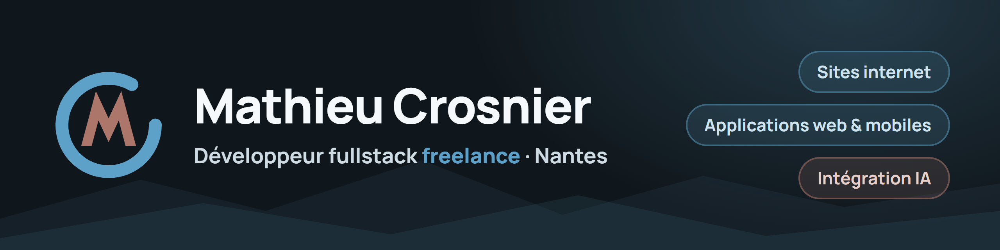
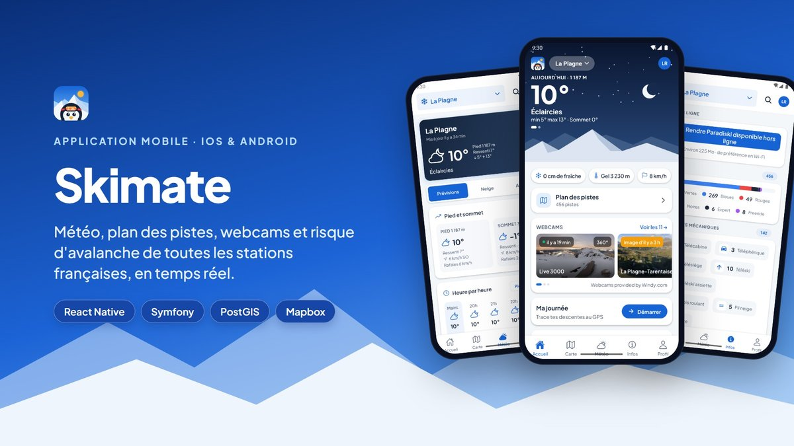
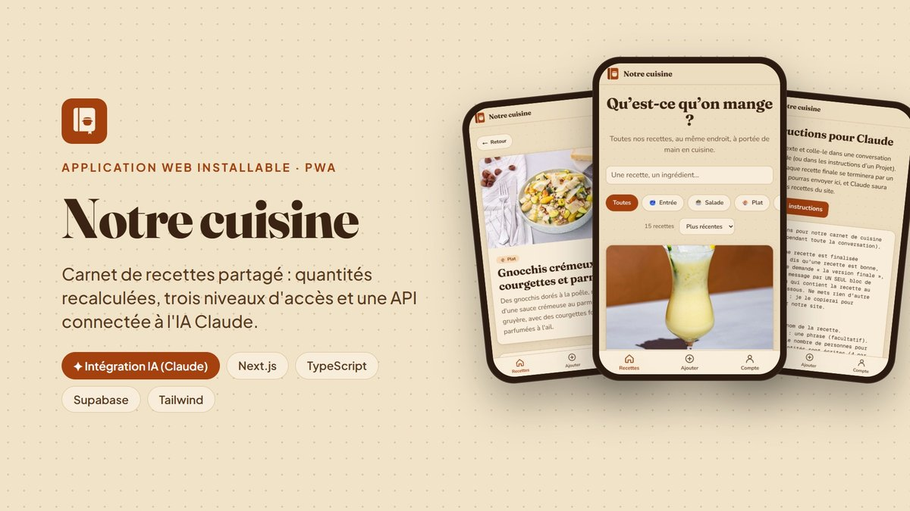
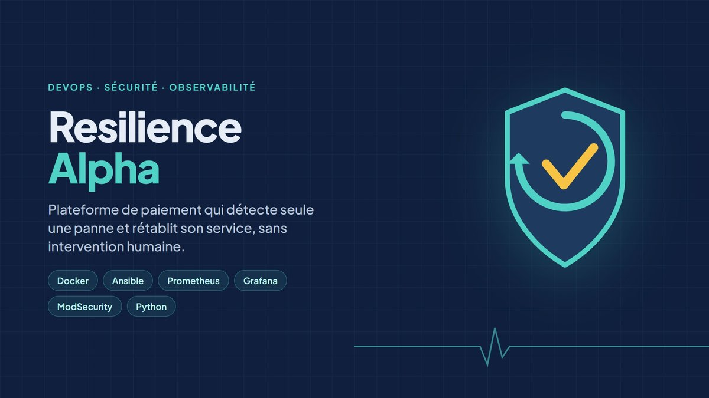
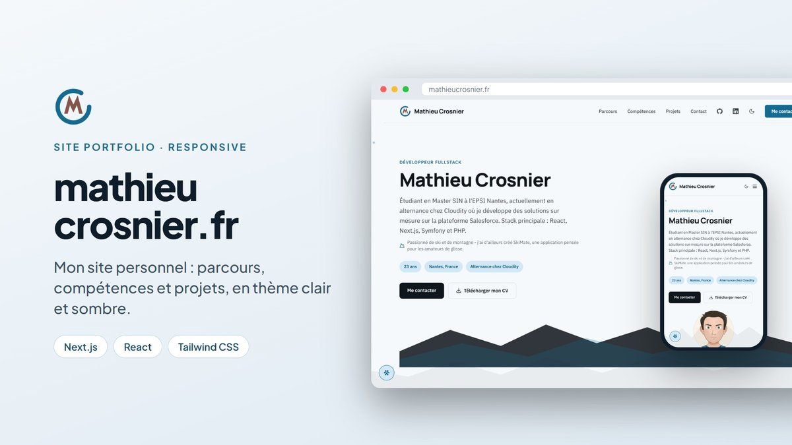

### Bonjour 👋 Je suis Mathieu, développeur fullstack freelance à Nantes.

Je conçois et développe des **sites internet**, des **applications web et mobiles** et des **outils qui intègrent l'IA**, de la maquette à la mise en ligne.

- 🌐 **Sites internet** : sites vitrines et sur mesure, rapides, lisibles sur téléphone et bien construits pour Google
- 📱 **Applications web et mobiles** : React, Next.js, React Native, avec une API Symfony ou Node.js
- 🤖 **Intégration IA** : assistants et automatisations branchés sur les API de Claude ou d'OpenAI

### 🛠️ Stack

### 🚀 Projets

<table>
  <tr>
    <td width="50%" valign="top">
      
      <h4>SkiMate 🚧</h4>
      Application mobile iOS et Android pour les skieurs : météo, plan des pistes, webcams et risque d'avalanche des stations françaises. 
      React Native · Symfony · PostGIS · Mapbox 
      <em>En cours de développement</em>
    </td>
    <td width="50%" valign="top">
      
      <h4>Notre cuisine</h4>
      Application web installable : un carnet de recettes partagé, avec des quantités recalculées selon le nombre de personnes et un lien avec l'IA Claude. 
      Next.js · TypeScript · Supabase · Tailwind 
      <a href="https://cuisine.mathieucrosnier.fr">Voir l'appli</a> · <a href="https://github.com/mat37dev/notre-cuisine">Code</a>
    </td>
  </tr>
  <tr>
    <td width="50%" valign="top">
      
      <h4>Resilience Alpha</h4>
      Plateforme de paiement de démonstration qui détecte seule une panne et rétablit son service, sans intervention humaine. Projet d'école en équipe. 
      Docker · Ansible · Prometheus · Grafana · Python 
      <a href="https://github.com/mat37dev/resilience-alpha">Code</a>
    </td>
    <td width="50%" valign="top">
      
      <h4>mathieucrosnier.fr</h4>
      Mon site, conçu de A à Z : design, logo, textes et développement. 
      Next.js · React · Tailwind CSS 
      <a href="https://mathieucrosnier.fr">Voir le site</a> · <a href="https://github.com/mat37dev/portfolio">Code</a>
    </td>
  </tr>
</table>

### 🎓 Parcours

Master SIN, option IA, à l'EPSI Nantes (en cours) · 2 ans de développement web à l'ESIMA (Armée de l'Air et de l'Espace) · Titre de concepteur développeur d'applications (RNCP niveau 6)

### 📫 Me contacter

Un projet ? Écrivez-moi depuis [mathieucrosnier.fr](https://mathieucrosnier.fr), je réponds sous 24 h.

  
